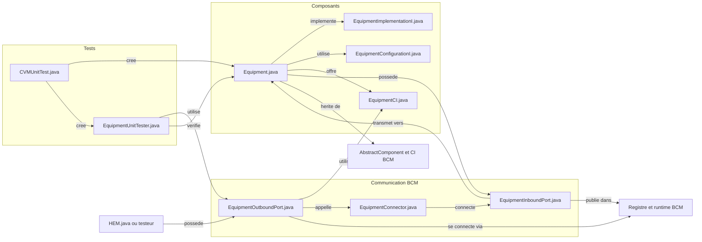
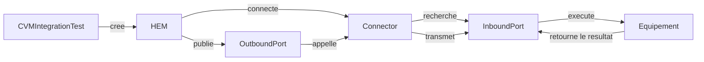

# Graphe de dependances des equipements HEM

Ce document decrit les dependances entre les fichiers du projet `HEM-2026-etape1-21092026-src`. Il distingue les dependances de compilation, les dependances BCM entre composants et les dependances utilisees uniquement par les tests.

## Perimetre analyse

L'analyse couvre principalement :

- `hem-2026-base` : interfaces communes du HEM ;
- `hem-2026-e1` : composants et equipements de l'etape 1 ;
- `hem-adapter` : adaptation XML du chauffage ;
- BCM4Java : composants, ports, connecteurs et cycle de vie ;
- BCM4JavaCyPhy : mesures physiques et mesures temporelles.

Les fichiers `doc/` et les fichiers `.class` contenus dans les JAR ne sont pas consideres comme des sources de dependances a modifier. Ils sont des sorties generees ou des bibliotheques compilees.

## Resultat de la verification

Le graphe est globalement conforme au projet pour les composants, les interfaces CI, les ports, les connecteurs et le test d'integration. Les dependances suivantes ont toutefois ete distinguees apres verification des imports et des appels `doPortConnection` :

| Relation | Verdict | Explication |
|---|---|---|
| `HEM` vers les equipements, CI, ports et connecteurs | Confirmee | `HEM.java` importe ces classes et les connecte dans `start()`. |
| `CVMIntegrationTest` vers les equipements et `HEM` | Confirmee | `CVMIntegrationTest.java` cree chaque composant avec `createComponent`. |
| Testeurs vers outbound ports et connecteurs | Confirmee | Les classes `*UnitTester.java` publient un outbound port et appellent `doPortConnection`. |
| Equipement vers `ImplementationI` et `ConfigurationI` | Confirmee | Chaque composant implemente son interface d'implementation, qui etend la configuration. |
| `RegistrationCI` vers `HEM` | Non realisee | L'interface existe dans `hem-2026-base`, mais `HEM.java` ne l'importe pas et ne l'implemente pas dans cette etape. |
| Descripteur XML vers Javassist | Prevue, pas directe | Le XML decrit une adaptation potentielle ; il n'importe pas Javassist. Le connecteur manuel montre l'objectif futur. |
| `HEM` vers `CVMIntegrationTest` | Confirmee mais anormale | `HEM.java` utilise `CVMIntegrationTest.CLOCK_URI`, ce qui cree une dependance du code metier vers le lanceur de test. |

Le graphe utilise donc des fleches pleines pour les dependances confirmees par le code et des fleches en pointilles pour les relations prevues ou conceptuelles.

## Architecture des dependances

```mermaid
flowchart TD
    subgraph Framework["Framework technique"]
        BcmJar["BCM4Java JAR"]
        CyPhyJar["BCM4JavaCyPhy JAR"]
        BcmComponent["AbstractComponent"]
        BcmPorts["Ports BCM"]
        BcmConnectors["Connecteurs BCM"]
        BcmCvm["CVM et cycle de vie"]
        BcmClock["ClocksServer"]
    end

    subgraph Base["Contrats HEM"]
        Adjustable["AdjustableCI"]
        Registration["RegistrationCI non utilisee"]
        EquipmentContracts["Interfaces CI propres aux equipements"]
    end

    subgraph Application["Composants HEM et equipements"]
        Hem["HEM.java"]
        Integration["CVMIntegrationTest.java"]
        HemTests["UnitTester classes"]
        Meter["ElectricMeter"]
        Batteries["Batteries"]
        Solar["SolarPanel"]
        Generator["Generator"]
        Weather["WeatherStation"]
        Heater["Heater"]
        HairDryer["HairDryer"]
    end

    subgraph Adapter["Adaptation dynamique"]
        AdapterSchema["control-adapter.rnc"]
        HeaterDescriptor["heaterci-descriptor.xml"]
        Javassist["javassist.jar"]
        Jing["jing.jar"]
    end

    BcmJar --> BcmComponent
    BcmJar --> BcmPorts
    BcmJar --> BcmConnectors
    BcmJar --> BcmCvm
    BcmJar --> BcmClock
    CyPhyJar --> Meter
    CyPhyJar --> Batteries
    CyPhyJar --> Solar
    CyPhyJar --> Generator
    CyPhyJar --> Weather
    CyPhyJar --> Heater
    CyPhyJar --> HairDryer

    BcmComponent --> Hem
    BcmPorts --> Meter
    BcmPorts --> Batteries
    BcmPorts --> Solar
    BcmPorts --> Generator
    BcmPorts --> Weather
    BcmPorts --> Heater
    BcmPorts --> HairDryer
    BcmConnectors --> Hem
    BcmCvm --> Integration
    BcmClock --> Hem

    Adjustable --> Hem
    Adjustable --> Heater
    Registration -.->|"contrat prevu, non implemente"| Hem
    EquipmentContracts --> Meter
    EquipmentContracts --> Batteries
    EquipmentContracts --> Solar
    EquipmentContracts --> Generator
    EquipmentContracts --> Weather
    EquipmentContracts --> Heater
    EquipmentContracts --> HairDryer

    Integration --> Hem
    Integration --> Meter
    Integration --> Batteries
    Integration --> Solar
    Integration --> Generator
    Integration --> Weather
    Integration --> Heater
    Integration --> HairDryer
    Hem --> HemTests
    HemTests --> Meter
    HemTests --> Batteries
    HemTests --> Solar
    HemTests --> Generator
    HemTests --> Weather
    HemTests --> Heater
    Hem --> Integration

    AdapterSchema --> HeaterDescriptor
    HeaterDescriptor -.->|"decrit le controle cible"| Heater
    HeaterDescriptor -.->|"entree potentielle"| Javassist
    Jing -.->|"validation XML potentielle"| AdapterSchema
```

<!-- mermaid-checked: no \n, no em-dash/en-dash, no {} in labels, subgraphs are id["label"], arrows are -->|"label"|, all subgraphs closed by end, ids unique -->


## Organisation d'un equipement

La plupart des equipements suivent le meme decoupage de fichiers :

```text
<equipment>/
├── <Equipment>.java
├── <Equipment>CI.java
├── <Equipment>ImplementationI.java
├── <Equipment>ConfigurationI.java
├── connections/
│   ├── <Equipment>InboundPort.java
│   ├── <Equipment>OutboundPort.java
│   └── <Equipment>Connector.java
├── <Equipment>UnitTester.java
└── CVMUnitTest.java
```

Le graphe suivant montre le lien entre ces fichiers. Les noms generiques representent le schema commun applique a `meter`, `batteries`, `solar_panel`, `generator`, `weather_station` et `hairdryer`. Le `heater` possede une structure plus riche avec plusieurs interfaces et plusieurs familles de ports.

<!-- mermaid-checked: no \n, no em-dash/en-dash, no {} in labels, subgraphs are id["label"], arrows are -->|"label"|, all subgraphs closed by end, ids unique -->


## Lecture du graphe

### 1. Composant principal

Le fichier `<Equipment>.java` est le centre de l'equipement. Il :

- herite de `AbstractComponent` ;
- contient l'etat interne de l'equipement ;
- cree et publie ses ports entrants ;
- implemente les operations metier ;
- gere son cycle de vie `start`, `execute`, `finalise` et `shutdown`.

Exemples :

- `meter/ElectricMeter.java` ;
- `batteries/Batteries.java` ;
- `heater/Heater.java` ;
- `solar_panel/SolarPanel.java`.

### 2. Interface CI

Le fichier `<Equipment>CI.java` definit le contrat public de l'equipement. Il indique les operations visibles par les autres composants sans exposer l'implementation interne.

Exemples :

- `ElectricMeterCI` pour les mesures electriques ;
- `BatteriesCI` pour l'etat et la capacite des batteries ;
- `SolarPanelCI` pour la production solaire ;
- `GeneratorCI` pour le generateur ;
- `WeatherStationCI` pour les temperatures ;
- `HeaterExternalControlCI` pour le controle externe du chauffage.

### 3. Port entrant

`<Equipment>InboundPort.java` expose le contrat CI du composant serveur. Il recoit les appels d'un autre composant et les redirige vers l'objet `<Equipment>.java`.

Exemple :

```text
HEM
 |
 +-- ElectricMeterOutboundPort
          |
          +-- ElectricMeterConnector
                    |
                    +-- ElectricMeterInboundPort
                              |
                              +-- ElectricMeter
```

### 4. Port sortant

`<Equipment>OutboundPort.java` est utilise par le client. Il fournit des methodes pratiques qui deleguent les appels au connecteur courant.

Le HEM possede par exemple :

```text
ElectricMeterOutboundPort
BatteriesOutboundPort
SolarPanelOutboundPort
GeneratorOutboundPort
WeatherStationOutboundPort
AdjustableOutboundPort
```

Ces ports se trouvent dans les packages `connections` de chaque equipement, sauf `AdjustableOutboundPort` qui appartient au package du HEM.

### 5. Connecteur

`<Equipment>Connector.java` fait le lien entre le port sortant et le port entrant. Il adapte les appels de l'interface requise vers l'interface offerte.

Dans le cas standard, le connecteur transmet simplement l'appel :

```text
appel du client
    -> outbound port
    -> connector
    -> inbound port
    -> composant serveur
```

Le chauffage possede en plus plusieurs connecteurs :

```text
HeaterUserConnector.java
HeaterInternalControlConnector.java
HeaterExternalControlConnector.java
HeaterConnector.java
```

`HeaterConnector.java` est le connecteur personnalise utilise par le HEM dans cette etape. Il illustre le connecteur qui pourra ensuite etre genere automatiquement a partir du descripteur XML.

## Dependances du HEM

Le fichier `HEM.java` depend directement de plusieurs familles de fichiers :

| Dependance | Fichiers utilises | Role |
|---|---|---|
| BCM | `AbstractComponent`, annotations, exceptions BCM | Base du composant et cycle de vie |
| Horloge | `ClocksServer`, `ClocksServerCI`, `ClocksServerConnector`, `ClocksServerOutboundPort` | Synchronisation temporelle |
| Compteur | `ElectricMeterCI`, `ElectricMeterConnector`, `ElectricMeterOutboundPort` | Lecture des mesures electriques |
| Batteries | `BatteriesCI`, `BatteriesConnector`, `BatteriesOutboundPort` | Lecture et controle du stockage |
| Panneau solaire | `SolarPanelCI`, `SolarPanelConnector`, `SolarPanelOutboundPort` | Lecture de la production solaire |
| Generateur | `GeneratorCI`, `GeneratorConnector`, `GeneratorOutboundPort` | Lecture et controle du generateur |
| Station meteo | `WeatherStationCI`, `WeatherStationConnector`, `WeatherStationOutboundPort` | Lecture des temperatures |
| Chauffage | `AdjustableCI`, `AdjustableOutboundPort`, `HeaterConnector` | Controle par modes, suspension et reprise |
| Tests | `TestsStatistics` et classes `UnitTester` | Execution des scenarios de verification |

Le HEM ne depend pas directement des attributs internes des equipements. Il depend de leurs interfaces, ports et connecteurs.

## Dependances par equipement

### ElectricMeter

```text
ElectricMeter.java
├── ElectricMeterCI.java
├── ElectricMeterImplementationI.java
├── ElectricMeterConfigurationI.java
├── connections/ElectricMeterInboundPort.java
├── connections/ElectricMeterOutboundPort.java
├── connections/ElectricMeterConnector.java
└── ElectricMeterUnitTester.java
```

Role : mesurer la tension et les informations electriques du logement.

### Batteries

```text
Batteries.java
├── BatteriesCI.java
├── BatteriesImplementationI.java
├── BatteriesConfigurationI.java
├── connections/BatteriesInboundPort.java
├── connections/BatteriesOutboundPort.java
├── connections/BatteriesConnector.java
└── BatteriesUnitTester.java
```

Role : modeliser la capacite de stockage, la charge, la production et l'etat des batteries.

### SolarPanel

```text
SolarPanel.java
├── SolarPanelCI.java
├── SolarPanelImplementationI.java
├── SolarPanelConfigurationI.java
├── connections/SolarPanelInboundPort.java
├── connections/SolarPanelOutboundPort.java
├── connections/SolarPanelConnector.java
└── SolarPanelUnitTester.java
```

Role : modeliser une source de production solaire dont la puissance depend notamment de la surface du panneau et des conditions meteorologiques.

### Generator

```text
Generator.java
├── GeneratorCI.java
├── GeneratorImplementationI.java
├── GeneratorConfigurationI.java
├── GeneratorState.java
├── connections/GeneratorInboundPort.java
├── connections/GeneratorOutboundPort.java
├── connections/GeneratorConnector.java
└── GeneratorUnitTester.java
```

Role : modeliser une source d'energie avec un etat et un reservoir.

### WeatherStation

```text
WeatherStation.java
├── WeatherStationCI.java
├── WeatherStationImplementationI.java
├── WeatherStationConfigurationI.java
├── connections/WeatherStationInboundPort.java
├── connections/WeatherStationOutboundPort.java
├── connections/WeatherStationConnector.java
└── WeatherStationUnitTester.java
```

Role : fournir les temperatures interieure et exterieure utilisees par les simulations et le controle du chauffage.

### Heater

Le chauffage est plus complexe que les autres equipements car il expose plusieurs interfaces :

```text
Heater.java
├── HeaterUserCI.java
├── HeaterInternalControlCI.java
├── HeaterExternalControlCI.java
├── HeaterUserI.java
├── HeaterInternalControlI.java
├── HeaterStateI.java
├── HeaterConfigurationI.java
├── connections/HeaterUserInboundPort.java
├── connections/HeaterUserOutboundPort.java
├── connections/HeaterUserConnector.java
├── connections/HeaterInternalControlInboundPort.java
├── connections/HeaterInternalControlOutboundPort.java
├── connections/HeaterInternalControlConnector.java
├── connections/HeaterExternalControlInboundPort.java
├── connections/HeaterExternalControlJava4InboundPort.java
├── connections/HeaterExternalControlOutboundPort.java
├── connections/HeaterExternalControlConnector.java
├── HeaterUnitTester.java
└── CVMUnitTest.java
```

Le chauffage est relie a trois types de clients :

```text
Utilisateur
    -> HeaterUserCI

Controle interne
    -> HeaterInternalControlCI

HEM
    -> HeaterExternalControlCI ou AdjustableCI
```

### HairDryer

```text
HairDryer.java
├── HairDryerUserCI.java
├── HairDryerImplementationI.java
├── HairDryerConfigurationI.java
├── HairDryerState.java
├── HairDryerMode.java
├── connections/HairDryerInboundPort.java
├── connections/HairDryerOutboundPort.java
├── connections/HairDryerConnector.java
└── HairDryerTester.java
```

Le seche-cheveux possede une interface utilisateur, mais il n'est pas inscrit comme equipement ajustable du HEM dans cette etape. Il sert principalement a simuler une charge electrique non controlable.

## Dependances des tests

Les classes `CVMUnitTest.java` et `*UnitTester.java` utilisent principalement :

```text
CVMUnitTest
├── AbstractCVM
├── AbstractComponent.createComponent
├── equipement a tester
└── ClocksServer si le test est temporel

UnitTester
├── port sortant de l'equipement
├── connecteur de l'equipement
├── assertions et preconditions
└── TestsStatistics
```

Le test d'integration [CVMIntegrationTest.java](HEM-2026-etape1-21092026-src/hem-2026-e1/fr/sorbonne_u/components/hem2026e1/CVMIntegrationTest.java) relie l'ensemble des composants :

```text
CVMIntegrationTest
├── ClocksServer
├── ElectricMeter
├── Batteries
├── SolarPanel
├── Generator
├── WeatherStation
├── HairDryer et HairDryerTester
├── Heater et HeaterUnitTester
└── HEM
```

## Flux d'execution des dependances

<!-- mermaid-checked: no \n, no em-dash/en-dash, no {} in labels, subgraphs are id["label"], arrows are -->|"label"|, all subgraphs closed by end, ids unique -->


## Regle de lecture rapide

Pour comprendre un appel entre deux equipements, suivre toujours ce chemin :

```text
1. Interface CI
2. OutboundPort du client
3. Connector
4. InboundPort du serveur
5. Composant serveur
6. Implementation interne
```

Pour comprendre un test :

```text
1. CVMUnitTest ou CVMIntegrationTest
2. creation du composant
3. creation du testeur
4. creation du port sortant
5. connexion par le connecteur
6. appel des operations
7. verification des resultats
```

## Resume des dependances

| Niveau | Fichiers principaux | Depend de | Fonction |
|---|---|---|---|
| Framework | `BCM4Java-21092026.jar` | Java | Runtime de composants, ports, connecteurs et CVM |
| Mesures | `BCM4JavaCyPhy-21092026.jar` | BCM et Java | Mesures physiques et temporelles |
| Contrats | `hem-2026-base` | BCM | Interfaces communes du HEM |
| Equipements | `hem-2026-e1/equipments` | Contrats, BCM et mesures | Composants metier |
| Adaptateurs | `hem-adapter` | Interfaces chauffage, Jing, Javassist | Adaptation XML et connecteurs dynamiques |
| Tests | `*UnitTester.java`, `CVMUnitTest.java` | Equipements et BCM | Verification unitaire |
| Integration | `CVMIntegrationTest.java` | Tous les equipements et ClocksServer | Assemblage et execution du systeme |
