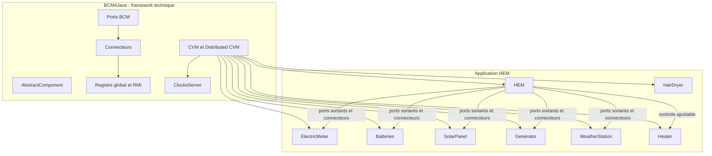
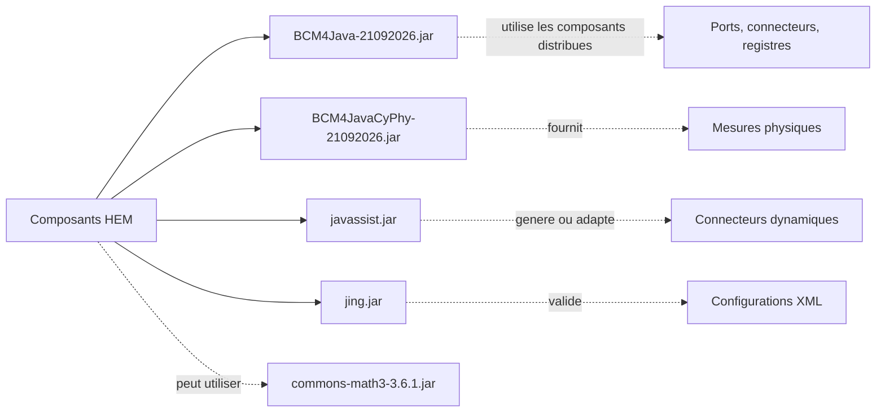

# ALASCA - Etape 1

Ce dossier contient la premiere etape du projet ALASCA, un systeme de gestion de l'energie domestique construit avec le framework de composants distribues **BCM4Java**.

L'objectif de cette etape est de mettre en place :

- le framework de composants distribues ;
- les composants representant les equipements domestiques ;
- le composant HEM (*Home Energy Manager*) ;
- les interfaces de communication entre composants ;
- les ports et les connecteurs BCM ;
- les tests unitaires et les tests d'integration ;
- le mecanisme d'adaptation des interfaces par description XML.

## Architecture generale



## Organisation du dossier

```text
ALASCA-etape-1/
├── BCM4Java-21092026-src/
│   ├── src/                  # Coeur du framework BCM4Java
│   ├── src-basic-plugins/    # Extensions et plugins de base
│   ├── examples/             # Exemples de composants et de deploiements
│   ├── test_tools/           # Outils de test
│   ├── config/               # Schema de configuration des deploiements
│   ├── bash-scripts/         # Scripts de lancement sous Unix/Linux
│   └── doc/                  # Documentation generee
├── HEM-2026-etape1-21092026-src/
│   ├── hem-2026-base/        # Interfaces et contrats communs
│   ├── hem-2026-e1/          # Implementation de l'etape 1
│   └── hem-adapter/          # Descripteurs XML d'adaptation
├── *.jar                     # Bibliotheques deja compilees
├── transparents/             # Supports de cours
└── readme.md                 # Cette documentation
```

## BCM4Java

BCM4Java est le socle technique du projet. Il fournit un modele de composants permettant de construire des applications locales ou distribuees.

Ses responsabilites principales sont :

- la creation des composants ;
- la gestion du cycle de vie ;
- la communication entre composants ;
- la publication et la recherche des ports ;
- les connexions locales ou distantes ;
- la synchronisation entre plusieurs JVM ;
- les horloges accelerees pour les simulations ;
- les tests et la reflexion sur les composants.

Un composant BCM herite generalement de `AbstractComponent` et possede le cycle de vie suivant :

```text
start()
   |
execute()
   |
finalise()
   |
shutdown()
```

### Ports et connecteurs

BCM separe les interfaces offertes et les interfaces requises :

```text
Composant client
	|
	+-- OutboundPort       port sortant
			|
			+-- Connector  transmet les appels
					|
					+-- InboundPort   port entrant
							|
							+-- Composant serveur
```

- Un **inbound port** est un point d'entree offert par un composant.
- Un **outbound port** est utilise par un composant client.
- Une **interface CI** definit les operations autorisees.
- Un **connector** transmet ou adapte les appels.

Cette separation permet de communiquer avec un composant sans acceder directement a ses attributs internes. Elle permet aussi de deplacer un composant dans une autre JVM.

## Deploiement distribue

La configuration d'un deploiement BCM est decrite dans un fichier XML conforme au schema [deployment.rnc](BCM4Java-21092026-src/config/deployment.rnc).

Elle definit :

- les machines participantes ;
- la barriere cyclique de synchronisation ;
- le registre global ;
- le port du registre RMI ;
- les JVM et leurs classes principales.

```text
JVM applicatives
	   |
	   +-- Registre RMI local
					|
					+-- Registre global

Toutes les JVM
	   |
	   +-- Cyclic Barrier pour synchroniser le demarrage
```

Les scripts de lancement sont disponibles dans [BCM4Java-21092026-src/bash-scripts](BCM4Java-21092026-src/bash-scripts). Ils sont ecrits pour Bash sous Unix/Linux et peuvent necessiter une adaptation sous Windows.

## Projet HEM

Le projet HEM est separe en trois modules logiques.

### `hem-2026-base`

Ce module contient les interfaces communes et les contrats metier.

#### `AdjustableCI`

`AdjustableCI` represente un equipement dont la consommation peut etre controlee. Il definit notamment :

```text
maxMode()
upMode()
downMode()
setMode(...)
currentMode()
getModeConsumption(...)
suspended()
suspend()
resume()
emergency()
```

Cette interface permet au HEM de reduire ou de restaurer la consommation d'un equipement comme le chauffage.

#### `RegistrationCI`

`RegistrationCI` definit le mecanisme theorique d'enregistrement dynamique d'un equipement :

```java
register(uid, controlPortURI, xmlControlAdapter)
unregister(uid)
registered(uid)
```

L'objectif est de permettre a un equipement de se declarer aupres du HEM sans que le HEM connaisse a l'avance toutes ses classes concretes.

### `hem-2026-e1`

Ce module contient les composants de l'etape 1 :

```text
equipments/
├── batteries/
├── generator/
├── hairdryer/
├── heater/
├── hem/
├── meter/
├── solar_panel/
└── weather_station/
```

Chaque equipement suit en general la structure suivante :

```text
Equipement
├── Equipement.java              implementation du composant
├── EquipementCI.java            interface offerte
├── EquipementImplementationI.java
├── EquipementConfigurationI.java
├── connections/
│   ├── EquipementInboundPort.java
│   ├── EquipementOutboundPort.java
│   └── EquipementConnector.java
├── EquipementUnitTester.java    tests unitaires
└── CVMUnitTest.java              lancement de test isole
```

## Composants metier

### `HEM`

Le composant [HEM.java](HEM-2026-etape1-21092026-src/hem-2026-e1/fr/sorbonne_u/components/hem2026e1/equipments/hem/HEM.java) est l'orchestrateur du systeme.

Il possede des ports sortants vers :

- `ElectricMeter` ;
- `Batteries` ;
- `SolarPanel` ;
- `Generator` ;
- `WeatherStation` ;
- `Heater`.

Dans `start()`, le HEM connecte ces ports aux ports entrants des equipements. Dans `execute()`, il recupere l'horloge, attend le debut de la simulation et lance les scenarios de test.

### `ElectricMeter`

Le compteur represente la mesure electrique du logement. Il fournit les donnees necessaires au suivi de la tension et de la consommation.

### `Batteries`

Le composant batteries represente un stockage d'energie. Ses etats sont :

```text
CHARGING   batteries en charge
PRODUCING  batteries en train de fournir de l'energie
EMPTY      batteries vides
IDLE       batteries au repos
```

Il gere notamment la capacite nominale, la puissance de charge et la puissance maximale de sortie.

### `SolarPanel`

Le panneau solaire represente une source de production. Sa production depend notamment de sa surface et des informations meteorologiques.

### `Generator`

Le generateur represente une source d'energie supplementaire. Il gere son etat, sa production et son reservoir.

### `WeatherStation`

La station meteorologique fournit des informations comme :

- la temperature interieure ;
- la temperature exterieure.

Ces informations peuvent ensuite etre utilisees pour controler le chauffage ou estimer la production solaire.

### `Heater`

Le chauffage est l'equipement ajustable principal de cette etape. Il possede plusieurs interfaces :

```text
HeaterUserCI
	commandes utilisateur : marche, arret, temperature cible

HeaterInternalControlCI
	etat physique interne du chauffage

HeaterExternalControlCI
	controle par le HEM : modes, suspension, reprise, urgence
```

Ses etats sont :

```text
OFF       chauffage arrete
ON        chauffage allume mais ne chauffant pas
HEATING   chauffage en fonctionnement
```

Le composant gere aussi la temperature cible, la puissance courante et plusieurs niveaux de puissance.

### `HairDryer`

Le seche-cheveux est volontairement non controlable par le HEM. Il sert a representer un equipement dont la consommation doit etre mesuree mais qui ne peut pas etre arbitrairement suspendu par le gestionnaire.

## Adaptateurs XML

Le module [hem-adapter](HEM-2026-etape1-21092026-src/hem-adapter) contient :

- [control-adapter.rnc](HEM-2026-etape1-21092026-src/hem-adapter/control-adapter.rnc) : schema du format XML ;
- [heaterci-descriptor.xml](HEM-2026-etape1-21092026-src/hem-adapter/heaterci-descriptor.xml) : adaptation du chauffage.

Le descripteur XML explique comment traduire les operations generiques du HEM vers les operations concretes d'un equipement.

Exemple :

```text
Le HEM demande : setMode(3)
	   |
	   +-- l'adaptateur calcule la puissance du mode 3
	   +-- il modifie la puissance du chauffage
	   +-- il met a jour le mode courant
```

Cette approche permet de connecter des equipements qui n'exposent pas exactement la meme interface que celle attendue par le HEM. Javassist est utilise pour faciliter la generation ou la compilation dynamique des connecteurs.

## Lancement de l'integration

Le point d'entree de l'integration est [CVMIntegrationTest.java](HEM-2026-etape1-21092026-src/hem-2026-e1/fr/sorbonne_u/components/hem2026e1/CVMIntegrationTest.java).

Il cree les composants suivants :

```text
ClocksServer
ElectricMeter
Batteries
SolarPanel
Generator
WeatherStation
HairDryer
HairDryerTester
Heater
HeaterUnitTester
HEM
```

Le scenario d'execution est :

```text
1. Creation de l'horloge acceleree
2. Creation des equipements
3. Creation du HEM
4. Demarrage du cycle de vie BCM
5. Connexion des ports
6. Synchronisation sur l'horloge
7. Execution des tests des equipements
8. Execution du scenario du chauffage
9. Arret propre des composants
```

## Tests

Les tests sont organises en trois niveaux :

```text
Tests unitaires
	CVMUnitTest.java dans chaque equipement

Tests des interfaces
	*UnitTester.java

Test d'integration
	CVMIntegrationTest.java
```

Les tests verifient notamment :

- les valeurs initiales ;
- les connexions entre ports ;
- les preconditions et postconditions ;
- les changements d'etat ;
- les changements de mode ;
- la suspension et la reprise ;
- les valeurs de consommation ;
- la synchronisation temporelle.

## Limites de l'etape 1

Cette version est une base pedagogique et non un HEM complet.

- L'enregistrement automatique des equipements est defini par `RegistrationCI`, mais n'est pas encore completement implemente dans `HEM`.
- Les testeurs remplacent temporairement les actions d'utilisateurs.
- Le controle energetique global n'est pas encore finalise.
- Le chauffage utilise encore un connecteur personnalise ecrit manuellement.
- Le seche-cheveux n'est pas controle par le HEM.
- Les scripts fournis sont principalement prevus pour Unix/Linux.
- Certains fichiers de configuration contiennent des chemins absolus propres a l'environnement d'origine.

## Resume

```text
BCM4Java
	fournit le modele distribue

HEM
	orchestre les equipements

Equipements
	simulent les appareils de la maison

Interfaces CI
	definissent les contrats

Ports et connecteurs
	assurent la communication entre composants

CVM
	instancie et demarre le systeme

ClocksServer
	synchronise les scenarios

Adaptateurs XML
	permettent de connecter des equipements heterogenes
```

L'architecture globale est donc celle d'un systeme cyber-physique distribue : chaque appareil est un composant autonome, les composants communiquent par interfaces et ports, et le HEM coordonne la gestion de l'energie sans acceder directement a l'implementation interne des equipements.

## Archives JAR

Le dossier contient plusieurs archives Java `.jar`. Une archive JAR est un fichier ZIP structure pour Java. Elle peut contenir :

- des classes compilees `.class` ;
- des sources `.java` ;
- des fichiers de configuration ;
- un manifeste `META-INF/MANIFEST.MF` ;
- des metadonnees Maven ;
- des ressources utilisees a l'execution.

Les JAR sont utilises comme bibliotheques dans le classpath Java. Le classpath indique a la JVM et au compilateur ou trouver les classes necessaires au lancement et a la compilation du projet.

### Vue d'ensemble

| Archive | Entrees | Classes `.class` | Sources `.java` | Role |
|---|---:|---:|---:|---|
| `BCM4Java-21092026.jar` | 1097 | 640 | 346 | Framework BCM4Java et exemples |
| `BCM4JavaCyPhy-21092026.jar` | 292 | 165 | 93 | Donnees physiques et modeles cyber-physiques |
| `commons-math3-3.6.1.jar` | 1402 | 1301 | 0 | Bibliotheque de calcul scientifique Apache |
| `javassist.jar` | 450 | 426 | 0 | Generation et modification dynamique de bytecode Java |
| `jing.jar` | 718 | 629 | 0 | Validation de schemas XML et Relax NG |

Les nombres ci-dessus correspondent aux entrees presentes dans les archives fournies dans ce dossier. Les dossiers vides et certaines entrees techniques peuvent expliquer une difference entre le nombre d'entrees et le nombre de classes.

### `BCM4Java-21092026.jar`

Cette archive contient le framework principal BCM4Java. Elle contient a la fois les classes compilees et une partie importante des sources Java embarquees.

Son contenu comprend notamment :

```text
fr/sorbonne_u/components/
├── composants BCM
├── ports entrants et sortants
├── connecteurs
├── interfaces de composants
├── gestion du cycle de vie
├── CVM et Distributed CVM
├── registres RMI
├── synchronisation distribuee
├── outils de reflexion
├── exemples
└── outils de test
```

Les exemples inclus montrent plusieurs architectures :

- `basic_cs` : communication simple entre un fournisseur et un consommateur ;
- `pingpong` : communication entre composants ;
- `reflection` : utilisation de la reflexion BCM ;
- `ddeployment_cs` : deploiement distribue ;
- `cps` : exemple de systeme cyber-physique ;
- exemples de plugins BCM.

Cette archive est donc le coeur logiciel qui permet aux classes HEM d'heriter de `AbstractComponent`, de publier des ports et de communiquer avec les autres composants.

### `BCM4JavaCyPhy-21092026.jar`

Cette archive complete BCM4Java avec les types necessaires aux systemes cyber-physiques.

Elle contient principalement les packages :

```text
fr/sorbonne_u/alasca/
├── physical_data/
│   ├── Measure
│   ├── TimedMeasure
│   ├── CompoundMeasure
│   ├── MeasurementUnit
│   ├── TimingI
│   └── donnees physiques temporelles
└── components/
```

Les classes importantes sont :

- `Measure` : valeur physique associee a une unite ;
- `TimedMeasure` : valeur physique associee a une date ou un instant ;
- `CompoundMeasure` : mesure composee de plusieurs valeurs ;
- `MeasurementUnit` : representation des unites ;
- `PowerMeasure` : mesure de puissance ;
- `TimedPowerMeasure` : mesure de puissance datee.

Cette bibliotheque est utilisee par les equipements HEM. Par exemple, le chauffage ne manipule pas seulement un `double` pour sa puissance : il peut utiliser une mesure avec une unite et un instant associe.

```text
Mesure physique
	valeur : 2200.0
	unite  : watts
	temps  : instant de mesure
```

Cela evite de melanger des valeurs incompatibles, par exemple une temperature avec une puissance ou des watts avec des volts.

### `commons-math3-3.6.1.jar`

Cette archive est une bibliotheque externe Apache Commons Math. Elle ne contient pas de sources `.java` dans cette copie, uniquement des classes compilees et ses ressources.

Elle fournit des outils de calcul scientifique, notamment :

```text
org/apache/commons/math3/
├── analysis/          fonctions et analyses numeriques
├── linear/            algebre lineaire
├── complex/           nombres complexes
├── stat/              statistiques
├── distribution/      distributions de probabilite
├── regression/        regressions
├── interpolation/     interpolation
├── optimization/      optimisation
├── ode/               equations differentielles
├── ml/                machine learning
└── geometry/          geometrie
```

Cette bibliotheque est une dependance generale de calcul. Elle n'est pas le framework de composants et ne definit pas le HEM. Elle peut toutefois etre utilisee par des simulations, des calculs de production solaire, des modeles de consommation ou des tests numeriques.

### `javassist.jar`

Javassist est une bibliotheque de manipulation du bytecode Java. Elle permet de creer ou de modifier des classes pendant l'execution ou avant leur chargement par la JVM.

Ses packages principaux sont :

```text
javassist/
├── ClassPool             gestion des classes
├── CtClass               representation d'une classe
├── CtMethod              representation d'une methode
├── CtField               representation d'un attribut
├── bytecode/             lecture et creation de bytecode
├── compiler/             compilation de fragments Java
├── convert/              transformations de bytecode
├── expr/                 instrumentation d'expressions
├── tools/                outils complementaires
└── util/                 utilitaires et proxies
```

Dans ALASCA, Javassist est important pour le principe d'adaptation dynamique des connecteurs. Le HEM definit une interface generique, comme `AdjustableCI`, puis un descripteur XML explique comment appeler l'interface reelle de l'equipement. Un connecteur peut alors etre genere ou compile dynamiquement.

```text
Interface HEM : AdjustableCI
		  |
		  +-- Descripteur XML
		  |
		  +-- Javassist
					|
					+-- Connecteur adapte genere dynamiquement
```

### `jing.jar`

Jing est utilise pour valider des fichiers XML selon des schemas Relax NG et d'autres formats de schema XML.

Ses packages principaux sont :

```text
com/thaiopensource/
├── validation/
├── validate/
├── relaxng/
├── datatype/
├── resolver/
└── xml/
```

Dans le projet, Jing peut valider les fichiers de description XML et les schemas `.rnc`, notamment :

- `BCM4Java-21092026-src/config/deployment.rnc` ;
- `HEM-2026-etape1-21092026-src/hem-adapter/control-adapter.rnc` ;
- `HEM-2026-etape1-21092026-src/hem-adapter/heaterci-descriptor.xml`.

Le role de Jing est donc la validation de la structure des configurations. Il ne lance pas les composants et ne remplace pas BCM4Java.

## Relations entre les JAR

La dependance logique peut etre representee ainsi :



En pratique :

1. `BCM4Java-21092026.jar` fournit le runtime de composants.
2. `BCM4JavaCyPhy-21092026.jar` fournit les types de mesures physiques.
3. `javassist.jar` fournit la generation ou l'adaptation dynamique de code.
4. `jing.jar` valide les schemas et descripteurs XML.
5. `commons-math3-3.6.1.jar` fournit des fonctions mathematiques generales lorsqu'elles sont necessaires.

## Comment inspecter un JAR

### Lister le contenu

```powershell
jar tf BCM4Java-21092026.jar
```

La commande affiche les chemins internes de l'archive sans extraire les fichiers.

### Rechercher une classe

```powershell
jar tf BCM4Java-21092026.jar | Select-String "AbstractComponent"
```

### Lire une source Java embarquee

Lorsque le fichier `.java` est present dans l'archive, il peut etre extrait vers un fichier texte. Par exemple, sous PowerShell :

```powershell
jar xf BCM4Java-21092026.jar fr/sorbonne_u/components/AbstractComponent.java
```

Cette commande extrait la source en respectant son chemin interne.

### Examiner une classe compilee

Si seule la classe `.class` est disponible, `javap` permet d'afficher sa structure :

```powershell
javap -classpath BCM4Java-21092026.jar -public fr.sorbonne_u.components.AbstractComponent
```

Avec `-c`, il est aussi possible d'afficher les instructions bytecode :

```powershell
javap -classpath BCM4Java-21092026.jar -c fr.sorbonne_u.components.AbstractComponent
```

### Lire le manifeste

Le manifeste contient des informations generales sur l'archive :

```powershell
jar xf BCM4Java-21092026.jar META-INF/MANIFEST.MF
Get-Content META-INF/MANIFEST.MF
```

## Difference entre les sources et les JAR

Les dossiers sources restent la reference la plus pratique pour comprendre et modifier le projet :

```text
Sources .java
	lisibles et modifiables
	commentaires presents
	organisation par modules

JAR
	deja compile
	utilisable directement dans le classpath
	parfois accompagne de sources embarquees
	plus difficile a modifier directement
```

Dans ce projet, les JAR servent principalement a fournir les bibliotheques compilees necessaires. Les sources du framework et du HEM permettent de comprendre le fonctionnement et doivent etre privilegiees pour les modifications.

## Integration du framework BCM

Cette version du projet n'utilise pas Maven, Gradle ou Ant pour assembler BCM4Java. L'integration est faite manuellement avec :

1. les JAR BCM et leurs dependances ;
2. le classpath Java ;
3. les sources du HEM ;
4. la classe principale a lancer.

Le framework est donc ajoute au projet avec l'option `-cp` de `javac` et de `java`.

### Definir les chemins sous PowerShell

Depuis le dossier `Semestre3`, les commandes suivantes definissent les chemins utiles :

```powershell
$ROOT = (Resolve-Path "ALASCA\ALASCA-etape-1\ALASCA-etape-1").Path
$HEM = Join-Path $ROOT "HEM-2026-etape1-21092026-src"
$OUT = Join-Path $ROOT "build\classes"

$CP = @(
	(Join-Path $ROOT "BCM4Java-21092026.jar")
	(Join-Path $ROOT "BCM4JavaCyPhy-21092026.jar")
	(Join-Path $ROOT "javassist.jar")
	(Join-Path $ROOT "jing.jar")
	(Join-Path $ROOT "commons-math3-3.6.1.jar")
) -join ";"

New-Item -ItemType Directory -Force $OUT | Out-Null
```

Sous Windows, le separateur du classpath est `;`. Sous Unix/Linux, il est `:`.

### Compiler le projet HEM

La commande suivante recherche les sources du module de base et du module de l'etape 1, puis les compile dans `build/classes` :

```powershell
$SOURCES = @(
	Get-ChildItem (Join-Path $HEM "hem-2026-base") -Recurse -Filter *.java
	Get-ChildItem (Join-Path $HEM "hem-2026-e1") -Recurse -Filter *.java
).FullName

javac -encoding UTF-8 -cp $CP -d $OUT $SOURCES
```

Signification des options :

```text
-encoding UTF-8  encodage des fichiers sources
-cp              bibliotheques disponibles pendant la compilation
-d               dossier de destination des fichiers .class
```

La compilation produit une arborescence correspondant aux packages Java, par exemple :

```text
build/classes/
└── fr/sorbonne_u/components/hem2026e1/
	├── CVMIntegrationTest.class
	└── equipments/
```

### Lancer le test d'integration

Apres compilation, la classe principale de l'integration peut etre lancee avec :

```powershell
java -ea -cp "$OUT;$CP" fr.sorbonne_u.components.hem2026e1.CVMIntegrationTest
```

L'option `-ea` active les assertions Java utilisees dans les preconditions, postconditions et invariants du projet.

La classe lance les composants suivants :

```text
ClocksServer
ElectricMeter
Batteries
SolarPanel
Generator
WeatherStation
HairDryer
Heater
HEM
```

### Compiler et lancer un test individuel

Chaque equipement contient normalement une classe `CVMUnitTest`. Apres la compilation generale, elle peut etre lancee directement avec la meme syntaxe :

```powershell
java -ea -cp "$OUT;$CP" fr.sorbonne_u.components.hem2026e1.equipments.heater.CVMUnitTest
```

Exemples de classes de test individuelles :

```powershell
java -ea -cp "$OUT;$CP" fr.sorbonne_u.components.hem2026e1.equipments.batteries.CVMUnitTest
java -ea -cp "$OUT;$CP" fr.sorbonne_u.components.hem2026e1.equipments.generator.CVMUnitTest
java -ea -cp "$OUT;$CP" fr.sorbonne_u.components.hem2026e1.equipments.meter.CVMUnitTest
java -ea -cp "$OUT;$CP" fr.sorbonne_u.components.hem2026e1.equipments.solar_panel.CVMUnitTest
java -ea -cp "$OUT;$CP" fr.sorbonne_u.components.hem2026e1.equipments.weather_station.CVMUnitTest
```

### Syntaxe minimale d'un composant BCM

Un composant applicatif herite de `AbstractComponent` :

```java
public class MyComponent extends AbstractComponent {
	protected MyComponent() throws Exception {
		super(1, 1);
	}

	@Override
	public synchronized void start() throws ComponentStartException {
		super.start();
	}

	@Override
	public synchronized void execute() throws Exception {
		// Activite du composant.
	}

	@Override
	public synchronized void finalise() throws Exception {
		super.finalise();
	}

	@Override
	public synchronized void shutdown() throws ComponentShutdownException {
		super.shutdown();
	}
}
```

Le constructeur `super(1, 1)` reserve un thread standard et un thread planifiable. Les valeurs sont a adapter selon le composant.

### Declarer une interface offerte

Une interface offerte represente les services qu'un composant fournit :

```java
public interface MyOfferedCI extends OfferedCI {
	public void doSomething() throws Exception;
}
```

Le composant peut ensuite declarer cette interface avec l'annotation BCM :

```java
@OfferedInterfaces(offered = {MyOfferedCI.class})
public class MyComponent extends AbstractComponent {
	// Implementation des operations offertes.
}
```

### Declarer une interface requise

Une interface requise represente les services dont un composant a besoin :

```java
public interface MyRequiredCI extends RequiredCI {
	public String getValue() throws Exception;
}
```

Le composant declare ensuite ses dependances :

```java
@RequiredInterfaces(required = {MyRequiredCI.class})
public class ClientComponent extends AbstractComponent {
	// Le composant pourra utiliser un outbound port de type MyRequiredCI.
}
```

### Creer et publier un port entrant

Le port entrant publie les services du composant serveur :

```java
protected MyInboundPort inboundPort;

this.inboundPort = new MyInboundPort("my-inbound-port", this);
this.inboundPort.publishPort();
```

Le port entrant doit deleguer l'appel au composant proprietaire ou a une methode de service du composant.

### Creer et publier un port sortant

Le port sortant est utilise par le composant client :

```java
protected MyOutboundPort outboundPort;

this.outboundPort = new MyOutboundPort(this);
this.outboundPort.publishPort();
```

### Connecter deux composants

La connexion associe :

- l'URI du port sortant ;
- l'URI du port entrant ;
- le nom complet du connecteur.

```java
this.doPortConnection(
	this.outboundPort.getPortURI(),
	"my-inbound-port",
	MyConnector.class.getCanonicalName());
```

La deconnexion se fait avec :

```java
this.doPortDisconnection(this.outboundPort.getPortURI());
```

### Creer un composant dans une CVM

Une CVM cree les composants avec `AbstractComponent.createComponent` :

```java
AbstractComponent.createComponent(
	MyComponent.class.getCanonicalName(),
	new Object[]{});
```

Pour transmettre des parametres au constructeur :

```java
AbstractComponent.createComponent(
	MyComponent.class.getCanonicalName(),
	new Object[]{10, true});
```

### Cycle de vie d'une CVM

Une classe de lancement herite de `AbstractCVM` et implemente `deploy()` :

```java
public class MyCVM extends AbstractCVM {
	@Override
	public void deploy() throws Exception {
		AbstractComponent.createComponent(
			MyComponent.class.getCanonicalName(),
			new Object[]{});

		super.deploy();
	}

	public static void main(String[] args) {
		try {
			MyCVM cvm = new MyCVM();
			cvm.startStandardLifeCycle(5000L);
			Thread.sleep(10000L);
			System.exit(0);
		} catch (Throwable e) {
			e.printStackTrace();
		}
	}
}
```

### Demarrage distribue avec un script

Les scripts BCM fournis utilisent une syntaxe Unix de ce type :

```bash
java -ea -cp 'jars/*' \
	 -Djava.security.policy=dcvm.policy \
	 fr.sorbonne_u.components.cvm.utils.DCVM_Launcher config.xml
```

Pour une JVM distribuee specifique :

```bash
java -ea -cp 'jars/*' \
	 -Djava.security.policy=dcvm.policy \
	 fr.sorbonne_u.components.testdistributed.DCVM1 jvmName config.xml
```

Sous Windows, l'equivalent du classpath est :

```powershell
java -ea -cp ".\jars\*" `
	 -Djava.security.policy=dcvm.policy `
	 fr.sorbonne_u.components.cvm.utils.DCVM_Launcher config.xml
```

Le fichier `config.xml` doit declarer les hosts, les ports du registre global, la cyclic barrier et les JVM participantes.

### Verification de l'environnement Java

Avant la compilation, verifier que le JDK est installe et que `javac`, `java` et `jar` sont accessibles :

```powershell
java -version
javac -version
jar --version
```

`javac` est necessaire pour compiler. Un simple environnement JRE ne suffit pas.

### Remarque sur Ant et les scripts existants

Le fichier `build.xml` situe dans `ALASCA/projet/jboss-javassist-javassist-71d5122` appartient a un autre projet Javassist. Il ne configure pas la compilation de `ALASCA-etape-1`.

Pour l'etape 1, les commandes documentees ici utilisent directement `javac` et `java`. L'echec de `ant -version` dans le terminal indique seulement qu'Ant n'est pas disponible dans le `PATH`; il ne signifie pas que BCM4Java est absent.

### Attention au Security Manager

Les anciens scripts BCM utilisent parfois :

```text
-Djava.security.manager
-Djava.security.policy=...
```

Ces options dependent fortement de la version du JDK. Le `SecurityManager` a ete desactive puis retire des versions recentes de Java. Pour commencer l'integration locale du HEM, utiliser d'abord la commande sans `-Djava.security.manager`, puis ajouter une policy uniquement si le deploiement distribue l'exige et si le JDK utilise la supporte.
